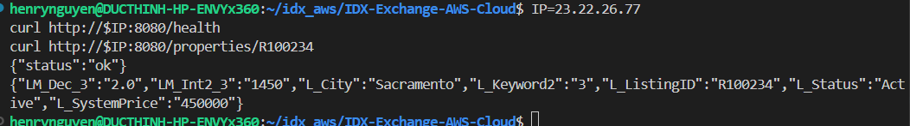
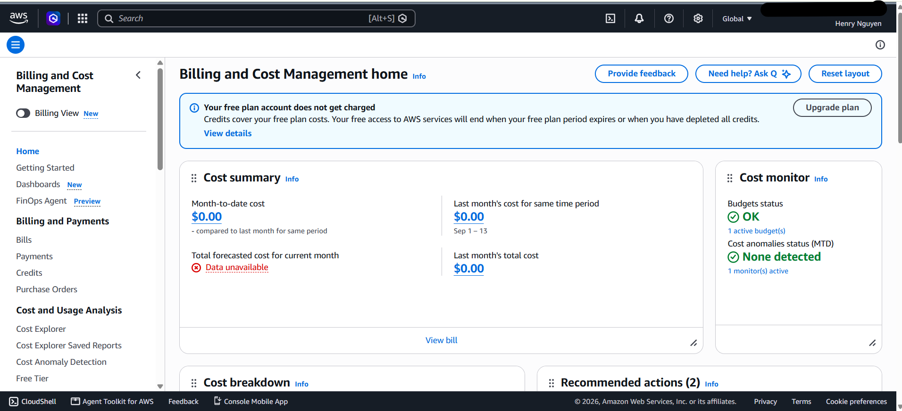

# Week 3 — Compute: EC2 Runbook

This runbook walks through how I deployed PropertyLite on an EC2 instance, took an EBS snapshot, debugged an SSH timeout, and cleaned everything up.
Everything was done in `us-east-1` (N. Virginia).

## Lab 3.1 — Deploy PropertyLite to EC2

### 1. Launch the instance

In the console, I went to EC2 → Instances → Launch instances and used these settings:

| Setting | Value |
|---|---|
| Name | `property-api-01` |
| AMI | Amazon Linux 2023, 64-bit (x86), Free tier eligible |
| Instance type | `t3.micro` (Free tier eligible) |
| Key pair | New RSA key pair `training-key`, `.pem` format |
| VPC / subnet | Default VPC, no subnet preference |
| Auto-assign public IP | Enable |
| Storage | 8 GiB gp3 (default) |

### 2. Security group

I let the wizard create a new security group (`launch-wizard-1`) with two inbound rules:

| Type | Port | Source | Why |
|---|---|---|---|
| SSH | 22 | My IP (`/32`) | Only my laptop can log in to the server |
| Custom TCP | 8080 | Anywhere (`0.0.0.0/0`) | PropertyLite listens on port 8080, so anyone can reach the API |

At first, I only had the 8080 rule because I changed the SSH rule instead of adding a new one, so I added SSH back as a second rule before launching.
I did not open port 80, because PropertyLite does not use it.

### 3. User data bootstrap script

Under Advanced details → User data, I pasted the bootstrap script from the handbook.
User data runs once as root on the first boot, so the server sets itself up without me logging in:

```bash
#!/bin/bash
yum update -y
yum install -y python3 python3-pip
pip3 install flask==3.0.3
mkdir -p /opt/property-api
cat > /opt/property-api/app.py << 'PYEOF'
# ... full propertylite/app.py from Week 0 ...
PYEOF
cat > /opt/property-api/rets_property_sample.csv << 'CSVEOF'
# ... the 3 starter rows from Week 0 ...
CSVEOF
cd /opt/property-api && nohup python3 app.py > /var/log/property-api.log 2>&1 &
```

The handbook only has a placeholder for `app.py`, so I filled in the full Week 0 code.
The filled-in script stays on my machine, because this repo is code only and does not include data rows.

### 4. Key pair permissions

The `.pem` file downloaded to Windows, so I copied it into WSL and locked it down:

```bash
cp <windows-download-folder>/training-key.pem ~/.ssh/
chmod 400 ~/.ssh/training-key.pem
```

`chmod 400` means only my user can read the key.
Without it, SSH refuses to use the key because the permissions are too open.
AWS does not let me download the key again, so I also kept a backup outside the repo.

### 5. Test from my laptop

After the instance showed Running and 3/3 status checks passed, I tested PropertyLite from my laptop:

```bash
curl http://<public-ip>:8080/health
# {"status":"ok"}
curl http://<public-ip>:8080/properties/R100234
# {"LM_Dec_3":"2.0","LM_Int2_3":"1450","L_City":"Sacramento","L_Keyword2":"3","L_ListingID":"R100234","L_Status":"Active","L_SystemPrice":"450000"}
```

This is the same app I tested locally in Week 0, now running on a real server.



### 6. SSH into the instance

```bash
ssh -i ~/.ssh/training-key.pem ec2-user@<public-ip>
```

The first time, SSH asked me to confirm the server's fingerprint, and I typed `yes`.
Inside the server, `curl localhost:8080/health` also returned `{"status":"ok"}`.
If the app had not started, I would check `/var/log/cloud-init-output.log` for user data errors and `/var/log/property-api.log` for Flask errors.

## Lab 3.2 — EBS snapshot

I went to EC2 → Volumes, selected the 8 GiB root volume of `property-api-01`, and chose Actions → Create snapshot with the description `property-api-01 root`.
Under EC2 → Snapshots, the snapshot reached Completed, with a full snapshot size of 1.7 GiB because only the used part of the disk is stored.
If I created a new volume from this snapshot, it would be an exact copy of the server's disk at that moment, so I could attach it to a new instance to recover the data or launch an identical server.

## Debug Lab 3.3 — SSH connection times out

To reproduce the problem, I edited the SSH inbound rule in `launch-wizard-1` and changed the source from My IP to `1.2.3.4/32`.
After that, SSH hung and failed:

```text
ssh: connect to host <public-ip> port 22: Connection timed out
```

I followed the handbook's checks.
The instance was still Running, so the server was not the problem.
Then I compared my current public IP (`curl -s ifconfig.me; echo`) with the source in the SSH rule, and they did not match.
I fixed it by editing the SSH rule back to My IP, and SSH worked again.

A timeout means the traffic is being blocked before it reaches the server, which points to the security group.
"My IP" is saved once when the rule is created and does not update by itself, so if my home IP changes, I need to update the rule.

## Cleanup

1. EC2 → Instances → `property-api-01` → Instance state → Terminate.
2. EC2 → Volumes: the root volume was deleted together with the instance.
3. EC2 → Snapshots: I deleted the snapshot, because snapshots stay after the instance is terminated and are charged for storage.
4. EC2 → Security Groups: I deleted `launch-wizard-1` after the instance was terminated.
5. I kept the `training-key` key pair, because Week 5 uses it again.

I confirmed with the CLI that there were no running instances, volumes, snapshots, or Elastic IPs left.
The Billing home page showed $0.00 month-to-date cost after cleanup.



## What I learned

User data lets a server set itself up on first boot, which is the first step toward not configuring servers by hand.
A security group is a firewall at the instance level, and it is stateful, so replies to allowed traffic go back out automatically.
SSH should only be open to my IP, while the app port can be open to everyone.
When SSH times out instead of being refused, I should check the security group and my current IP first.
