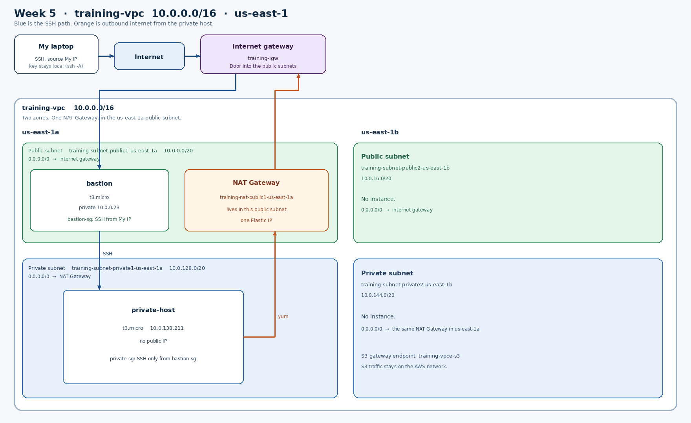

# Week 5 — Networking: VPC

I built a VPC by hand in `us-east-1`, put a bastion in a public subnet, and reached a second instance that had no public address. Everything in `training-vpc` was deleted the same day. The default VPC and the `training-key` key pair are still there.

## What the wizard created

The "VPC and more" wizard built the network from the name `training` and the CIDR `10.0.0.0/16`. That range is every address from `10.0.0.0` through `10.0.255.255`. I used two Availability Zones, two public subnets, two private subnets, and one NAT Gateway (Zonal, in 1 AZ).

| Piece | Name | Where |
|---|---|---|
| VPC | `training-vpc` | `10.0.0.0/16` |
| Public subnet | `training-subnet-public1-us-east-1a` | `10.0.0.0/20` |
| Public subnet | `training-subnet-public2-us-east-1b` | `10.0.16.0/20` |
| Private subnet | `training-subnet-private1-us-east-1a` | `10.0.128.0/20` |
| Private subnet | `training-subnet-private2-us-east-1b` | `10.0.144.0/20` |
| Internet gateway | `training-igw` | Attached to the VPC |
| NAT Gateway | `training-nat-public1-us-east-1a` | Public subnet in `us-east-1a`, with one Elastic IP |
| S3 gateway endpoint | `training-vpce-s3` | S3 traffic stays on the AWS network |

A public subnet is a subnet whose route table sends `0.0.0.0/0` to the internet gateway. A private subnet sends `0.0.0.0/0` to the NAT Gateway instead. `0.0.0.0/0` means any address outside this VPC. The route `10.0.0.0/16 → local` keeps traffic between my own subnets inside the VPC.

I launched instances only in `us-east-1a`. The `us-east-1b` subnets were there so the network had a second zone, and their private route table also pointed `0.0.0.0/0` at the single NAT Gateway.

## Path from my laptop to the private instance

1. My laptop opens SSH to the bastion's public IPv4 address. `bastion-sg` allows port 22 only from my current home IP.
2. The packet crosses the internet to `training-igw`, then into `training-subnet-public1-us-east-1a`, because that public subnet's route table points `0.0.0.0/0` at the internet gateway.
3. `bastion` (`t3.micro`, private address `10.0.0.23`) accepts the connection. I used `ssh -A`, so the private key stayed on my laptop and was only borrowed for the next hop.
4. From the bastion I SSH to `10.0.138.211`. That address is inside the private subnet `10.0.128.0/20`, so the packet stays on the local VPC route. It never goes out to the internet.
5. `private-host` has no public IP. `private-sg` allows port 22 only from `bastion-sg`, not from my home IP. My laptop cannot open this server directly.

The shell prompt `ip-10-0-138-211` is how I knew the second hop had landed on `private-host`.

## Why the private host could download packages

`private-host` has no public address, but `sudo yum update -y` still reached Amazon's repositories. The private subnet's route table, `training-rtb-private1-us-east-1a`, had:

| Destination | Target |
|---|---|
| `10.0.0.0/16` | local |
| `0.0.0.0/0` | the NAT Gateway |

The NAT Gateway lives in the public subnet, so it can use the internet gateway. Return traffic comes back through the NAT Gateway to the private instance. The internet cannot start a connection inward through it. That is why `yum` worked and a direct SSH to `10.0.138.211` from my laptop cannot.

The subnet also has to be associated with that route table. A route that no subnet is attached to does nothing. The wizard had already associated `training-subnet-private1-us-east-1a`, which is why the usual "yum hangs" failure did not happen.

## Cleanup

I terminated `bastion` and `private-host`, deleted the NAT Gateway, and released its Elastic IP. I then deleted `training-vpc`, which removed the subnets, route tables, internet gateway, gateway endpoint, and both security groups. The default VPC (`172.31.0.0/16`) is still in the account. A NAT Gateway bills about $0.045 an hour until it is deleted, and an unattached Elastic IP bills too.
