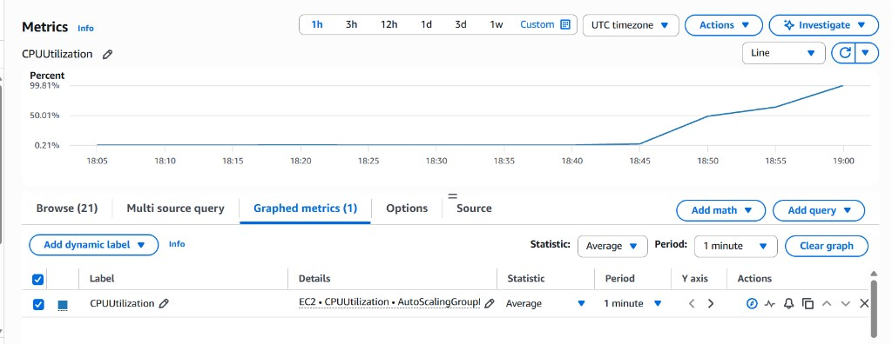
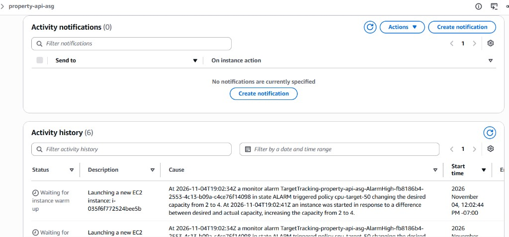

# Week 6 — Load test report

I rebuilt `training-vpc` (2 public + 2 private subnets, one NAT), put PropertyLite behind an internet-facing ALB with an Auto Scaling Group in the private subnets, proved self-healing, then stressed CPU until the group scaled out. Everything in `training-vpc` was deleted the same day. The default VPC and the `training-key` key pair are still there.

## What I built

| Piece | Name / setting |
|---|---|
| Launch template | `property-api-template` — Amazon Linux 2023, `t3.micro`, Week 3 user data, `app-sg` |
| Target group | `property-api-tg` — HTTP 8080, health check `/health` |
| ALB | `property-api-alb` — internet-facing, both public subnets, listener HTTP:80 → `property-api-tg` |
| ASG | `property-api-asg` — both private subnets, desired/min/max **2 / 1 / 4** |
| Scaling policy | `cpu-target-50` — target tracking, Average CPU utilization **50** |
| Security groups | `alb-sg` (80 from anywhere); `app-sg` (8080 from `alb-sg`, SSH from bastion) |

Lab 6.1 worked when:

```bash
curl -s "http://property-api-alb-791270549.us-east-1.elb.amazonaws.com/health"
# {"status":"ok"}
```

`/properties` and `/properties/R100234` returned the sample listings. Traffic path: laptop → ALB (public) → ASG instances (private) on port 8080. NAT was only for outbound `yum` / `pip` during user data.

## Lab 6.2 — Self-healing

I terminated one ASG instance in the console. Within about two minutes the Activity tab showed a replacement launch, and Desired stayed at 2. `curl` to the ALB `/health` still returned `{"status":"ok"}`.

## Lab 6.2 — CPU spike and scale-out

I SSHed through a short-lived bastion into both private instances and ran `stress-ng --cpu 2` so the ASG **average** CPU would rise well above 50% (one stressed host alone only averaged ~50% across two instances).

### CloudWatch CPU spike

ASG `CPUUtilization` (Average, 1-minute period) stayed near idle until about **18:45 UTC**, then climbed past 50% and toward ~**100%** by **19:00 UTC**.



### Scale-out event

At **2026-11-04T19:02:34Z**, alarm `TargetTracking-property-api-asg-AlarmHigh-…` entered ALARM and policy `cpu-target-50` raised Desired capacity from **2 to 4** (the group max). New instances started within seconds and entered the instance warm-up wait.



### Timestamp gap

| Event | Time (UTC) |
|---|---|
| CPU starts rising | ~18:45 |
| CPU near target / high | ~18:50–19:00 |
| Scale-out alarm → Desired 2→4 | **19:02:34** |

Gap from the start of the CPU rise to the scale-out action: about **17 minutes**. Most of that was building sustained high average CPU (and adding the target-tracking policy after I noticed the ASG had been created without one). After the policy existed and average CPU stayed above 50%, the alarm fired within a few minutes.

## Cleanup

Deleted in order: ASG (force, with instances) → ALB → target group → launch template → bastion → NAT Gateway → Elastic IP → `training-vpc`. Only the default VPC remains.
